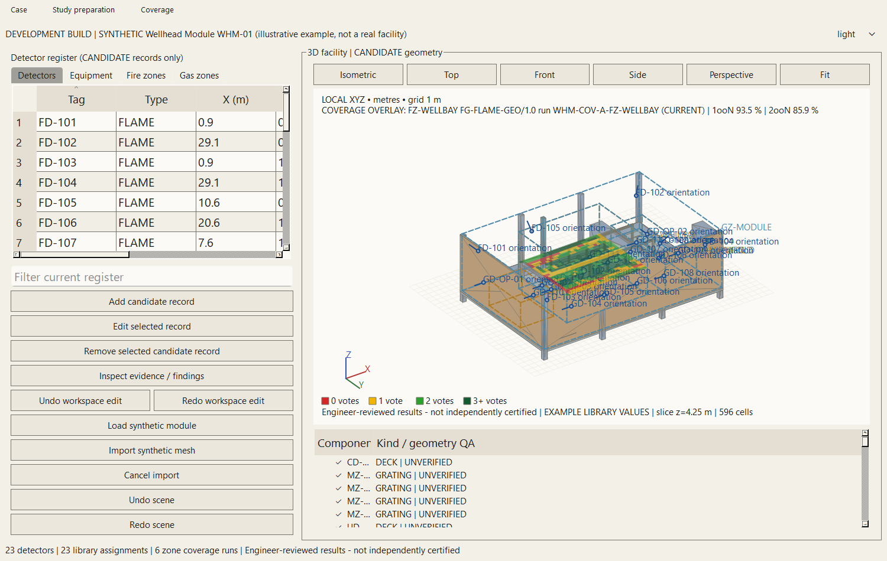
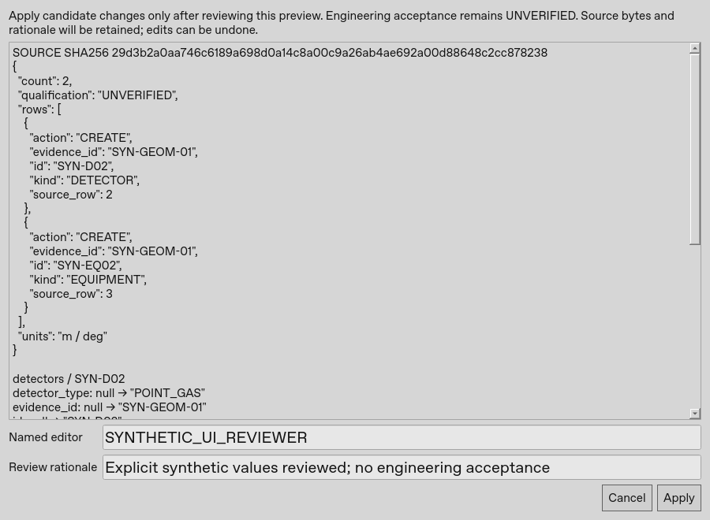
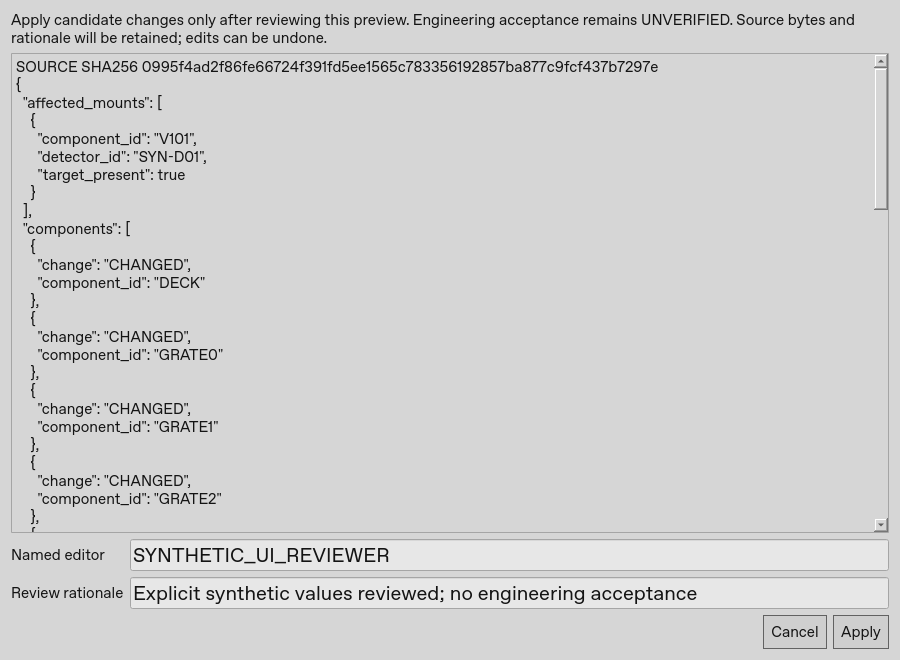
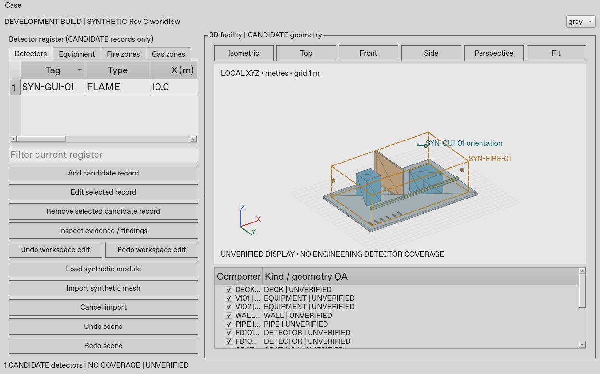
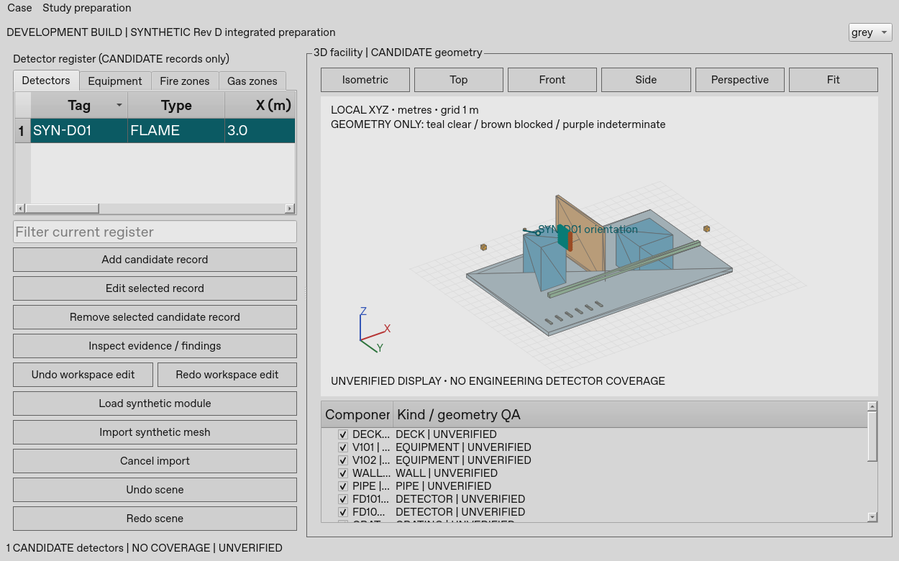

# Rev G user guide: running detector coverage

Results are engineer-reviewed and not independently certified. They depend entirely on the detector data and inputs you enter. The starter library and the wellhead example use EXAMPLE VALUES; replace them with verified manufacturer data before any project use.

1. **Enable the coverage schema.** Open a case, then choose Coverage > Enable coverage schema (schema 4). The upgrade is one-way, and a backup `*_pre_coverage4_*` is written first.
2. **Import a detector library.** Choose Coverage > Import detector library CSV / Excel. The format is `examples/library/STARTER_DETECTOR_LIBRARY_EXAMPLE_VALUES.csv`, or `.xlsx` with one sheet named `Library` and no formulas.
   - Each entry needs: type, fuel or gas, rated fire, FOV, the contour `angle:range;...` (flame), the alarm threshold (%LEL or LEL.m) and path range (gas), and the source document, revision, page and data status.
   - Entries are immutable by ID; give a corrected entry a new ID.
3. **Assign entries.** Select a detector, then choose Coverage > Assign library entry to selected detector. Every detector needs an explicit entry; there is no generic default. An open-path detector also needs a receiver, either an EQUIPMENT record with a `position` or explicit XYZ.
4. **Set up each zone.** Choose Coverage > Zone coverage setup and edit the JSON:
   - grid spacing, VOLUME or SLICES, and voting (1–3);
   - your own performance targets, for example `{"1ooN":"0.90","2ooN":"0.80"}` (the program has no built-in pass value);
   - convergence refinement and the criterion reference;
   - the target fire (flame zones) or the design cloud (gas zones).
5. **Check readiness.** Choose Coverage > Coverage readiness. Each zone shows READY, BLOCKED (with the reasons) or NOT CONFIGURED. Review items, such as EXAMPLE values, are listed but do not block.
6. **Run coverage.** Choose Coverage > Run coverage (all READY zones). The run happens in the background and can be cancelled. Every run is stored with its run ID, input hash and method version. Any later edit makes it STALE.
7. **Review the results.** Coverage > Coverage results / heatmap shows a table per zone. Select a zone and choose Show heatmap to see a plan slice coloured by votes (red 0, amber 1, green 2, dark green 3+). Use Show / hide detector FOV and Clear coverage overlay as needed.
8. **Run scenario studies (optional).**
   - Coverage > Scenario coverage takes user scenarios with frequencies and sources, and gives the frequency-weighted detected fraction.
   - Coverage > Layout options takes up to 16 candidates and gives a Pareto set of proposals only; the baseline layout is never changed.
9. **Export the report.** Coverage > Export coverage report writes JSON, XLSX, DOCX, PDF, heatmap PNGs and a hash manifest to a new folder.

**Worked example.** Open `examples/wellhead_coverage/SYNTHETIC_WELLHEAD_COVERAGE.fgcase` (open a copy). On the Windows PC, run `C:\Users\Admin\fg_dev\view\open_wellhead.bat`. To rebuild the example, run `python tools/build_wellhead_coverage_example.py NEW_FOLDER --grid 0.5 --refine 2`; it refuses to overwrite. Method details are in docs/REV_G_COVERAGE_METHOD.md.

# Rev E user guide
The inherited Rev D workflows below remain available. New commands are described first.

Case > Import synthetic register CSV / Excel accepts the supplied closed templates in examples/SYNTHETIC_BULK_REGISTER.csv/.xlsx. They are CREATE examples; using them in the saved Rev E case, which already contains those IDs, correctly refuses duplicates. To try CREATE, use a separate synthetic case with geometry schema enabled and the named evidence registered; to update existing unmounted rows explicitly change action to UPDATE. Every row is SYNTHETIC and names existing synthetic evidence; numeric detector orientation is required. Do not include formulas or extra sheets/headers. Preview shows before/after fields and source hash, then requires editor/rationale. Cancel makes no case change. Apply is one undoable command; source bytes/review remain retained after undo. Mounted detector edits require mount editing or detach, not bulk overwrite.

Case > Review synthetic facility revision accepts examples/SYNTHETIC_GEOMETRY_REVISION.json as a request template, not a revision to blindly reapply. The saved Rev E case already contains that revision; prepare a genuinely changed facility-only scene and explicit decisions for every affected mount. FOLLOW_COMPONENT reuses source-frame coordinates/physical offsets/orientation on the named target. KEEP_WORLD_DETACH retains world placement and removes the attachment. Missing decisions, unresolved equipment references, stale prior mounts and changed source units refuse apply. Detector display markers are retained separately. The preview requires named review and can be undone/redone. No surface mounting point or engineering approval is inferred.

Reports include retained source reviews, mount decisions, unresolved inputs and a Word mount schedule. Full raw source bytes and calculation/comparison artifacts remain in normalized JSON. Retained reviews do not mean changes are still applied after undo.

# Rev D candidate user guide — inherited workflow and additions
This program works offline with synthetic development data. No engineering detector coverage is available.

Open examples/SYNTHETIC_REV_C_CONNECTED.fgcase using Case > Open case. All four register tabs use virtual tables. Type in the filter to search cached fields; click a header to sort (XYZ sorts numerically). Right-click a header to choose visible columns or follow the selected row. Column layout is stored per PC. Ctrl+C copies selected cells and highlights them. Ctrl+X is explicitly refused because mandatory engineering fields cannot be implicitly cleared.

Use Add candidate record or Edit selected record. Detector forms collect ID, type, SI XYZ, orientation and evidence; a new evidence record requires description, revision and locator. Enter a named editor. Optional manufacturer/model/sensitivity entries are source fields only; supplying names does not create a performance dataset or permit engineering calculation. Explicit synthetic markers can be created. Marker cubes are display symbols, not physical detector dimensions, range or FOV.

For equipment, select a geometry component where supplied. Fire/gas zone forms use ordered lower/upper XYZ bounds in metres and a design-criterion reference. Unknown criteria remain NOT SUPPLIED and generate a preparation finding. Orientation arrows and dashed zone boxes are illustrative annotations; they are not coverage plots. Azimuth is +X toward +Y, elevation above XY; roll is retained but the direction glyph does not represent roll-dependent response.

Paste starts from the current detector Type or X/Y/Z cell. Ctrl+V opens a before/after preview; enter a named editor and Apply. Pasting can update existing Type/XYZ cells only. IDs, evidence and review status are protected. All cells commit together; linked markers move with them. Sorted/filtered row order maps to stable IDs.

Undo workspace edit / Redo workspace edit restores the new detector/record/paste/import commands across closing/reopening. New edits clear redo. A conflicting intervening change refuses history instead of overwriting it. Remove selected candidate record explicitly removes a detector/equipment/zone from the study; prior values remain in the ledger and source evidence is retained. Referenced detector geometry must be detached before removal. Legacy scene/name commands have separate history; the Scene Undo buttons remain for legacy synthetic scene replacement.

Import synthetic mesh parses triangulated OBJ or ASCII STL in a cancellable worker. Declare source units, datum and right-handed axes first. After parsing, review the source hash/frame/diagnostics, choose APPEND or REPLACE and name the reviewer. Applying creates CANDIDATE geometry, not engineering acceptance. Raw source bytes/provenance stay retained when the imported scene is undone. Source changes, duplicate components and invalid meshes are refused. Self-intersections, STEP and binary STL remain unsupported.

Inspect evidence / findings opens the selected source record and the preparation findings. Missing performance data, missing zone criteria, orphan links and stale runs remain visible. A finding list is not a standards assessment or sign-off.

Case > Run supplied synthetic exercise accepts the closed synthetic JSON contract. examples/SYNTHETIC_FIELD_PATH_EXERCISE.json demonstrates concentration/time interpolation and a beam integral with an explicitly selected resolution. This does not model dispersion, sensor qualification, FGS effectiveness or risk reduction.

Case > Export synthetic study reports freezes the current snapshot and illustrative viewer figure, asks for a new output folder, then generates JSON/Excel/Word/PDF/ZIP in a cancellable process. No further input is requested while that job runs. Parser QA compares all primary records and findings with the snapshot; visual/native Office and engineering review remain separate. Existing output folders are not overwritten.

Left-drag orbits; right-drag pans; wheel zooms; preset buttons provide standard views. Tree checkboxes hide display components. Camera/visibility survive ordinary refreshes and a per-case view is saved per PC. The rendering uses a CPU painter algorithm with known depth limits; calculations use separate numerical engines.

Save/close uses a local working copy and conflict checks. No on closing preserves unsaved work for explicit recovery. A .writer.lock sidecar can remain beside a case; it is operational and contains no project data. Do not remove locks while a writer is active. Windows abnormal-lock cleanup and OneDrive/multi-host semantics remain unverified.

# Rev D study preparation additions
Open examples/SYNTHETIC_REV_D_STUDY.fgcase. Use Study preparation for the following commands. Schema2 cases require explicit backed-up candidate schema3 enablement; original schema1 cases require geometry enablement first.

Select a detector, then Mount to component. Choose an actual facility component, source-local XYZ anchor, physical metre offsets, local azimuth/elevation/roll and evidence, then name the editor. Offsets rotate with the component but retain metre scale. Direct ordinary edit/paste of mounted detector coordinates is refused; detach or explicitly remount. Stale source geometry blocks readiness; mounting does not imply mechanical/engineering acceptance.

Set study basis: enter explicit study type/revision, coordinate/target/fuel references, voting, supplied criterion/target or NOT SUPPLIED, exclusion reasons/evidence and uncertainty reference. There is no default engineering target. Readiness displays missing/blocking preparation inputs separately from the always-BLOCKED engineering calculation gate. The supplied0.5 fixture is not a recommended target.

Import performance preparation JSON previews the strict SYNTHETIC-only contract (see examples/SYNTHETIC_PERFORMANCE_PREPARATION.json), then requires a new dataset ID and named editor. Link an exactly matching manufacturer/model/sensitivity to a detector with evidence. Record draft review with reviewer/rationale/evidence. Draft decisions cannot approve engineering; subject changes make earlier reviews stale. Real vendor data is not accepted in this development contract.

Geometric target inspection requires explicit origin, selected obstacles, rectangle center/U/V/width/height and sample grid/tolerance. It runs in a cancellable process and records individual traces. Teal=clear, brown=blocked, purple=indeterminate. The overlay and lower/upper bounds show selected geometric rays only, not fire/gas detector coverage. Do not use display markers as physical obstruction geometry.

Case > Compare with prior report JSON accepts an earlier snapshot of the SAME case UUID, then shows stable-ID changes. Export into a NEW report folder; comparison and readable summaries/schedules are included, with complete source/calculation/comparison artifacts in normalized JSON. Existing report directories are refused.

Case > Restore backup as new case verifies a selected backup and asks for a NEW .fgcase destination and named actor. It runs asynchronously, preserves the source and appends restoration audit. Never delete a live writer lock. If cancelled near completion, inspect the new destination before retrying. The saved synthetic example itself can be selected as a source for exercising restore-as-new.

